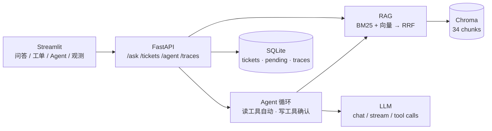

# FDE Support Copilot

**给客服团队用的企业知识库 + 工单 Agent。**
问政策类问题时从本地知识库检索并带引用作答；问订单/工单时让模型调用工具；
任何写操作（建单、改状态）都必须先变成待确认单，人工同意后才落库。

> 单人从零实现的完整链路：分块 → 分词 → 向量/BM25 混合检索 → FastAPI → Agent 工具调用 → 人工确认 → 流式界面 → 观测与评测。
> 不依赖 LangChain 等框架，每一层都能解释。

## 架构



详细分层、两条时序图、10 条"决策 + 代价"见 [docs/architecture.md](docs/architecture.md)。

## 快速开始

```powershell
pip install -r requirements.txt

# 环境变量（不要提交、不要截图）
$env:LLM_API_KEY="sk-..."
$env:LLM_BASE_URL="https://api.deepseek.com/v1"
$env:LLM_MODEL="deepseek-chat"

python -m scripts.build_index          # 建向量库
python -m scripts.ticket_cli init-db   # 建表 + 种子数据

# 终端 A：API（http://127.0.0.1:8000/docs）
python -m uvicorn app.api.main:app --reload

# 终端 B：界面（http://127.0.0.1:8501）
python -m streamlit run app/ui/streamlit_app.py
```

5 分钟演示步骤（每步标注是否花钱）见 [docs/demo.md](docs/demo.md)；
也可以直接跑 `python -m scripts.demo_walkthrough`（需要 API 已启动）。

## 接口

| 方法 | 路径 | 说明 |
|---|---|---|
| GET | `/health` | 服务 / 数据库 / 索引状态 |
| POST | `/ask` | 知识库问答，返回 answer + citations + hits |
| POST | `/ask/stream` | SSE 流式：`meta` → `delta*` → `done`/`error` |
| GET | `/tickets` | 列表，可按状态 / 客户过滤 |
| GET | `/tickets/{id}` | 详情 + 事件时间线 |
| POST | `/tickets` | 创建，201 + `Location` |
| PATCH | `/tickets/{id}/status` | 更新状态，非法流转 409 |
| POST | `/agent/chat` | Agent 对话；写操作返回 `pending` |
| POST | `/agent/confirm` | 确认 / 拒绝；重复确认幂等 |
| GET | `/traces` | 最近调用摘要（可按类型过滤） |
| GET | `/metrics/summary` | 调用数、状态分布、p50/p95 |

错误统一为 `{"error": {"type": ..., "message": ...}}`：
404 资源不存在 / 400 业务规则 / 409 状态冲突 / 422 结构不合法 / 502 上游失败 / 503 索引为空。

## 关键设计

| 设计 | 为什么 | 代价 |
|---|---|---|
| RRF 融合而非分数加权 | 余弦与 BM25 量纲不同，加权等于单方面加权 BM25 | 只看名次，丢失分数强度 |
| 写操作两阶段确认 | 模型输出不可信，不能直接触发副作用 | 交互多一步，需要 pending 表 |
| `pending_actions` 落库 | `--reload`、多 worker、崩溃都会丢内存待办 | 每次多一次数据库往返 |
| 越权返回 404 而非 403 | 403 等于确认"这个 id 存在" | 排查时需看日志区分 |
| 路由全部 `def` | 依赖都是同步库，`async def` 会阻塞事件循环 | 并发上限约为线程池大小 |
| 流式 trace 用独立连接 | 请求级 `yield` 依赖在流开始前就关闭 | 多一次建连 |

## 评测（诚实版）

| 模式 | hit@1 | recall@4 |
|---|---|---|
| vector | 0.818 | 0.909 |
| bm25 | 0.818 | 1.000 |
| hybrid | 0.818 | 1.000 |

**34 个 chunk 上 hybrid 与 BM25 持平，未观测到融合增益。**
相关性门槛也经校准后**关闭**：absent 与 in-domain 的 top1 分数重叠
（0.5842 > 0.5728），不存在可用阈值。完整报告见 [data/eval/report.md](data/eval/report.md)。

## 测试与脚本

```powershell
python -m pytest -q                    # 8 个测试，不联网、不调模型
python -m scripts.eval_retrieval       # 三模式 hit@1 / recall@k
python -m scripts.calibrate_relevance  # 分数分布与可分性判定
python -m scripts.eval_report          # 重新生成评测报告
python -m scripts.demo_walkthrough     # 对运行中的 API 跑一遍关键链路
```

## 目录

```text
app/
  rag/     分块、分词、向量/BM25、RRF、prompt
  llm/     模型协议（chat / chat_stream / tool_calls 解析）
  db/      表结构、仓储、业务规则（状态流转）
  agent/   工具注册、循环、确认状态机
  api/     路由、Pydantic 契约、统一错误映射
  obs/     trace 埋点
  ui/      Streamlit（只作为 HTTP 客户端）
scripts/   建索引、CLI、评测、校准、演示
docs/      架构、演示流程、能力映射
tests/     核心回归测试
```

## 已知限制

- **评测规模小**：34 chunk / 14 query，数字只能作方向参考。
- **无相关性门槛**：库外问题仍返回 top-k，靠 prompt 拒答；`RELEVANCE_MIN_SCORE` 可强制开启但会误拒。
- **Agent 无跨轮历史**：`session_id` 只绑定待确认单，"那帮我退了吧"会丢指代。
- **单机、无鉴权、无限流**：`session_id` 可伪造（但只能确认自己的待办）。
- **同步并发模型**：线程池约 40，高并发需异步客户端。

## 延伸材料

- [docs/architecture.md](docs/architecture.md) — 分层、时序、决策与代价
- [docs/demo.md](docs/demo.md) — 5 分钟演示
- [docs/fde-mapping.md](docs/fde-mapping.md) — 能力 → 项目证据
- `fde_copilot项目完成时遇到的问题和以后理解项目需要重点理解的点.md` — 按里程碑记录的工程日志（踩坑与修正）
