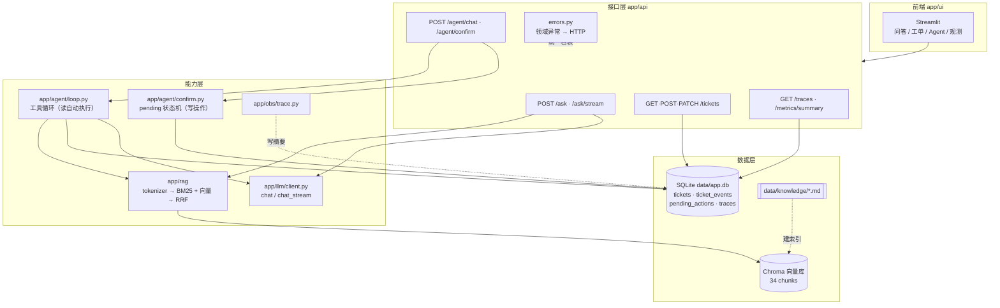
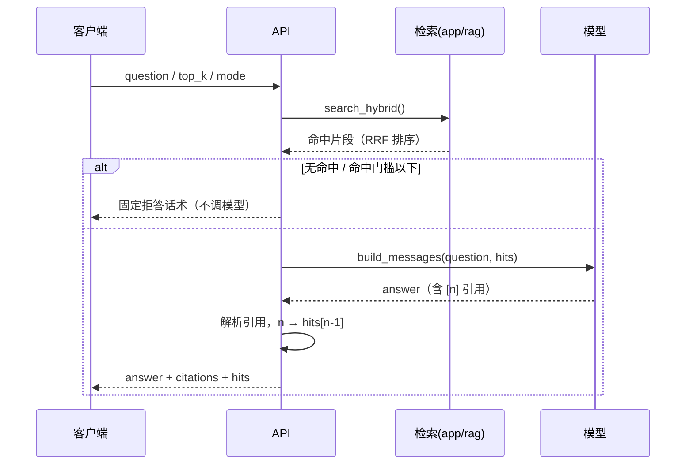
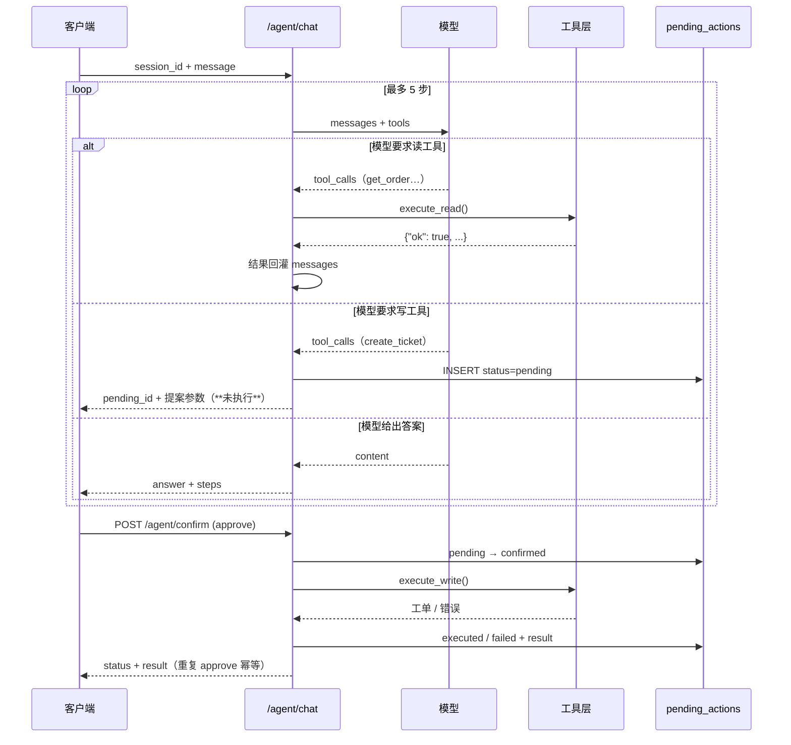

# 架构与关键决策

## 分层图



## 两条链路

### 1. RAG 问答（`/ask`、`/ask/stream`）



流式版本把最后一步换成 SSE：`meta` → `delta*` → `done` / `error`。

### 2. Agent（`/agent/chat` → `/agent/confirm`）



## 模块职责

| 目录 | 职责 | 不该做的事 |
|---|---|---|
| `app/rag/` | 分块、分词、向量/BM25 检索、RRF、prompt 拼装 | 不碰 HTTP，不知道工单 |
| `app/llm/` | 模型协议：请求、响应校验、SSE 解析、错误分类 | 不拼业务 prompt |
| `app/db/` | 表结构、仓储函数、业务规则（状态流转、客户/订单校验） | 不 import FastAPI |
| `app/agent/` | 工具注册、循环、确认状态机 | 不直接返回 HTTP 响应 |
| `app/api/` | 参数校验、错误映射、路由、埋点 | 不重写检索/工具逻辑 |
| `app/ui/` | 只作为 HTTP 客户端 | 不 import 业务模块 |

## 关键设计决策与代价

| 决策 | 为什么 | 代价 |
|---|---|---|
| **RRF 融合，不把两路分数加权** | 余弦 0~1、BM25 0~10+，量纲不同，加权等于单方面加权 BM25 | 丢失分数强度信息，只能比较名次 |
| **`candidate_k = max(top_k*3, 20)`** | 只拿 top_k 去融合，另一路靠后的命中进不来 | 每路多算十几条，34 chunk 下可忽略 |
| **工具参数用 Pydantic 二次校验** | 模型可能编参数；JSON Schema 只是提示，不是保证 | 多一层代码，但换来确定性 |
| **写操作两阶段确认** | 模型输出不可信，不能直接触发副作用 | 交互多一步；需要 pending 表和状态机 |
| **pending 落库，不内存** | `--reload` 重启、多 worker、崩溃都会丢内存待办 | 每步多一次数据库往返 |
| **越权返回 404 而非 403** | 403 等于告诉对方"这个 id 存在" | 排查时需要看日志才知道是越权还是不存在 |
| **只有 `/ask/stream` 是 `async def`** | 它主要是 IO 等待，用 `AsyncClient` 时线程不被占用；检索与写库用 `run_in_threadpool` 丢回线程池 | 多一层调度；`/agent/chat` 仍是同步（SQLite/工具都是同步库） |
| **流式 trace 用独立连接** | `yield` 依赖在路由返回时关闭，流在返回后才产生 | 多一次建连，代码多一条路径 |
| **相关性门槛默认关闭** | 评测集上 absent 与 in-domain 分数重叠（0.5842 vs 0.5728），无可用阈值 | 库外问题仍会返回 top-k，靠 prompt 拒答 |
| **前端只走 HTTP** | 换前端/加鉴权/拆服务不用动业务代码 | 前端无法复用类型，需要手写 schema |

## 数据模型

```text
customers ──< orders
    │
    └──< tickets ──< ticket_events
                       │
pending_actions ───────┘  （独立表：session_id/tool/arguments/status/result）
traces                      （独立表：kind/status/latency/steps/payload）
agent_messages              （独立表：session_id/role/content，只存自然语言轮次）
```

- `pending_actions.status`：`pending → confirmed → executed | failed`，另有 `rejected` / `expired`
- `traces.payload`：JSON 摘要，只存命中数、top_doc、引用数、错误类型名

## 错误映射

```text
NotFoundError   → 404   （工单/客户/确认单不存在，或不属于当前 session）
ValidationError → 400   （内容合法但业务不允许：订单不属于该客户）
ConflictError   → 409   （与资源当前状态冲突：非法流转、超时、重复确认失败单）
Pydantic        → 422   （结构不合法：缺字段、枚举值拼错）
IndexEmptyError → 503   （向量库为空）
LLMError        → 502   （上游模型失败）
未捕获异常      → 500   （响应体只有 internal_error，堆栈只进日志）
```

响应体统一 `{"error": {"type": "...", "message": "..."}}`；422 额外带 `fields`。
